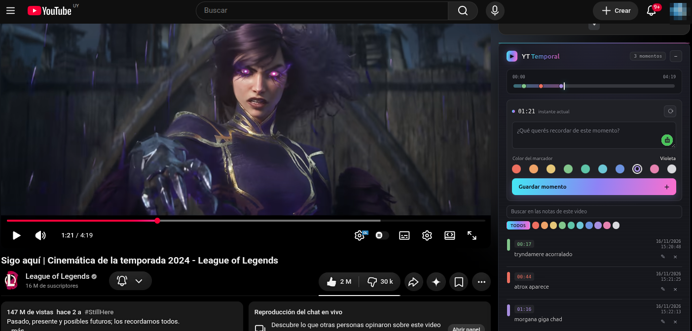
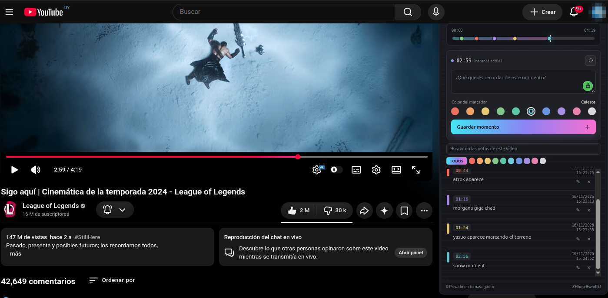
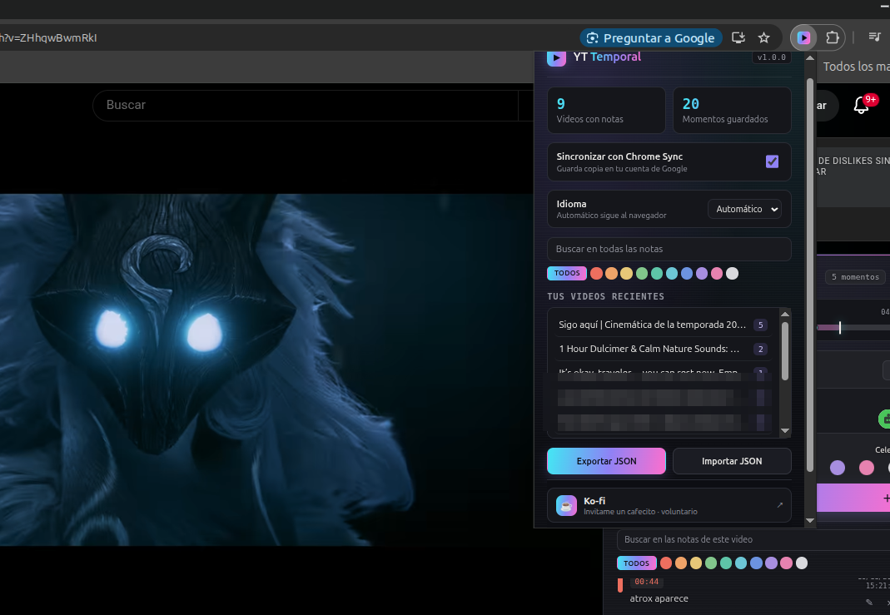

# YT Temporal Comments

**Guardá notas privadas con marcadores de color en momentos exactos de cualquier video de YouTube y encontralas desde tu propia línea de tiempo.**

Repositorio oficial: [MartnMartnez14/yt-temporal-comments](https://github.com/MartnMartnez14/yt-temporal-comments)

Estado: extensión completa y probada (v1.0.0, Manifest V3), bilingüe español/inglés. La cuenta de
desarrollador está registrada y verificada y el proyecto está listo para su publicación en la Chrome
Web Store. La extensión es gratuita y no tiene funciones de pago.

---

## Vista previa

Capturas de la extensión funcionando sobre YouTube (v1.0.0, Chrome real).

Panel de notas junto al reproductor: cada momento marcado queda en la línea de tiempo con su color,
su texto y la fecha y hora en que lo guardaste.



Editor de una nota: el instante actual se captura solo, elegís el texto y uno de los diez colores
sin perder el marcador.



Popup de la extensión: resumen de videos con notas, sincronización opcional con Chrome Sync,
selector de idioma, buscador general y los respaldos en JSON y Markdown.



---

## Estructura del Proyecto

El repositorio está organizado en dos entornos complementarios:

1. **`extension/` — Extensión para Google Chrome (Manifest V3):**
   Se inyecta directamente en `youtube.com/watch`, añadiendo una barra temporal de colores y un panel de notas privadas integrado junto al reproductor nativo de YouTube, además de un popup de gestión, sincronización (`chrome.storage.local` + `chrome.storage.sync`) y exportación/importación en JSON.
2. **`web-prototype/` — Prototipo Web Independiente (Flask):**
   Aplicación local ligera en Python/Flask que permite probar el concepto en una página independiente mediante la YouTube IFrame Player API y `localStorage`.

```text
ExtChromYoutComentColors/
├── extension/                 # Extensión de Chrome (Manifest V3)
│   ├── manifest.json
│   ├── icons/                 # PNG 16/32/48/128 px + fuentes SVG editables
│   ├── src/
│   │   ├── content/           # Inyección en YouTube (Shadow DOM + control de <video>)
│   │   ├── popup/             # Popup de la extensión (Resumen, Sync, Exportar/Importar JSON)
│   │   ├── storage/           # Capa de persistencia (local, sync y respaldos JSON)
│   │   └── utils/             # Utilidades puras (tiempos, fechas, colores, validación, IDs)
│   └── tests/                 # Pruebas con node:test (sin dependencias)
├── web-prototype/             # Prototipo web original en Python / Flask
│   ├── app.py
│   ├── requirements.txt
│   ├── templates/index.html
│   └── static/ (app.js, styles.css)
├── demo/                      # Capturas del proyecto
├── TUTORIAL.md                # Guía de uso para quien instala la extensión por primera vez
├── PRIVACY_POLICY.md          # Política de privacidad (ES / EN) para Chrome Web Store
└── CHANGELOG.md               # Historial de cambios
```

---

## Funciones Principales

- **Integración nativa en YouTube:** Funciona directamente sobre el reproductor de `youtube.com/watch` detectando la navegación dinámica (SPA) sin recargar la página.
- **Mapa visual por colores:** Creá notas en el segundo exacto y clasificálas con una paleta de 10 colores.
- **Cada nota con su fecha:** A la derecha de cada nota se muestra la fecha y hora local en que la guardaste (`dd/mm/aaaa` y `hh:mm:ss`), tomada del campo `createdAt` que ya viaja en los respaldos.
- **Sincronización con aviso:** si una nota no entra en el límite de Chrome Sync, se guarda igual en el equipo y el popup lo avisa, en vez de fallar en silencio.
- **Buscador y filtro:** buscá por texto (sin importar mayúsculas ni acentos) o filtrá por color dentro del video, y buscá en las notas de todos tus videos desde el popup.
- **Bilingüe español/inglés:** selector *Automático / Español / English* en el popup; el panel, el popup y las fechas cambian al instante, sin recargar la extensión.
- **Notas editables:** el lápiz de cada nota abre su texto y su color en línea, sin perder el instante ni la fecha de creación. `Esc` cancela y `Ctrl+Enter` guarda.
- **Identidad visual propia:** Panel oscuro con un degradé neón cian → violeta → rosa sobre el logo, el botón de guardar y el avance de la línea de tiempo. Los 10 colores de marcador quedan exclusivamente para tus notas: el color de la interfaz nunca se usa como color de etiqueta.
- **Se adapta a la vista:** en modo predeterminado vive en la columna lateral y en modo cine se reubica bajo el reproductor, antes de los comentarios.
- **Línea de tiempo proporcional:** Visualizá todos tus marcadores sobre la barra temporal y saltá a cualquier instante con un clic.
- **Atajo para capturar:** `Alt+N` lleva el cursor al campo de nota del instante actual sin salir del reproductor.
- **Persistencia híbrida y respaldos:**
  - Guardado inmediato en `chrome.storage.local`.
  - Sincronización opcional entre dispositivos con `chrome.storage.sync`.
  - Exportación e importación completa en archivo `.json` desde el popup de la extensión.
  - Exportación a **Markdown** con enlaces al instante (`https://youtu.be/<id>?t=<s>s`) para pegar en Notion, Obsidian o cualquier editor de texto.
- **Privacidad total:** Tus notas son privadas y nunca se publican como comentarios públicos en YouTube ni se envían a servidores externos.

---

## Cómo usar la Extensión de Chrome (Modo Desarrollador)

1. Cloná o descargá este repositorio:
   ```bash
   git clone https://github.com/MartnMartnez14/yt-temporal-comments.git
   ```
2. Abrí Google Chrome y navegá a `chrome://extensions/`.
3. Activá el interruptor **Modo de desarrollador** (esquina superior derecha).
4. Hacé clic en **Cargar descomprimida** (*Load unpacked*).
5. Seleccioná la carpeta `extension/` dentro de este proyecto.
6. Abrí cualquier video en [YouTube](https://www.youtube.com) y usá el panel **YT Temporal** para guardar momentos.

> Al modificar archivos de la extensión, recordá recargarla desde `chrome://extensions/` con el botón de recarga de la tarjeta y volver a cargar la pestaña de YouTube: las extensiones cargadas sin comprimir no se actualizan solas.

---

## Desarrollo y Pruebas

Las pruebas de la extensión usan el runner nativo de Node (`node:test`), sin dependencias que instalar:

```bash
cd extension
node --test tests/extension.test.js
```

Salida esperada: `ℹ tests 42`, `ℹ pass 42`, `ℹ fail 0`. Cubren la validación y el saneamiento de notas (incluyendo claves de prototipo al importar JSON), la capa de almacenamiento contra un mock de `chrome.storage`, el formateo de fechas, la exportación JSON y Markdown, el índice de videos, el contrato de render del panel (fecha/hora por nota, eventos del reloj, atajo `Alt+N`, edición de notas y reubicación en modo cine), el bilingüe (mismas claves en ambos idiomas, fechas y nombres de colores), accesibilidad WCAG 2.2 AA (`:focus-visible`, `aria-expanded` y navegación por teclado) y reglas de seguridad estática (sin `innerHTML`, sin recursos remotos y sin datos de cobro en el paquete).

El CSS del panel vive en `extension/src/content/content.css` y se publica como texto en
`extension/src/content/styles.js`, generado con:

```bash
node tools/build-css.mjs          # regenera styles.js
node tools/build-css.mjs --check  # verifica que estén sincronizados
```

Las pruebas fallan si `styles.js` quedó desactualizado: después de tocar el CSS, hay que
regenerarlo.

Los iconos se mantienen como SVG editable y se exportan a PNG con Inkscape:

```bash
cd extension/icons
inkscape --export-type=png --export-filename=icon128.png --export-width=128 --export-height=128 icon.svg
```

`icon.svg` alimenta los tamaños 48 y 128; `icon-small.svg` tiene la geometría ajustada para 16 y 32 px.

---

## Cómo ejecutar el Prototipo Web (Flask)

Si querés correr el sandbox web original en local:

```bash
cd web-prototype
python3 -m venv .venv
source .venv/bin/activate
python -m pip install -r requirements.txt
python app.py
```

Luego abrí <http://127.0.0.1:5000> en tu navegador.

---

## Documentación del Proyecto

- [Tutorial de uso (TUTORIAL.md)](TUTORIAL.md)
- [Política de Privacidad (PRIVACY_POLICY.md)](PRIVACY_POLICY.md)
- [Historial de Cambios (CHANGELOG.md)](CHANGELOG.md)

---

## Apoyar el proyecto

La extensión es gratuita, sin funciones de pago y sin publicidad. Si te resulta útil y querés
colaborar de forma **voluntaria**, podés invitarle un café al creador para apoyar el desarrollo y
las próximas mejoras:

- [Ko-fi — invitame un café](https://ko-fi.com/martinmartinezgarcia)

La donación es opcional y no desbloquea ninguna función: la extensión funciona igual sin ella.

---

## Contacto

Para dudas, errores o pedidos de mejora del proyecto:

- WhatsApp: [+598 92 663 680](https://wa.me/59892663680)
- Correo: <mmartinez23bio@hotmail.com>
- Problemas y sugerencias: [issues del repositorio](https://github.com/MartnMartnez14/yt-temporal-comments/issues)

---

## Licencia

Este proyecto se distribuye bajo la licencia MIT. Consultá el archivo [LICENSE](LICENSE).

---

*Guiño: las capturas de esta página salieron de una tarde viendo videos. Perdón, pero me encanta
Leo Leslie. 😄*
